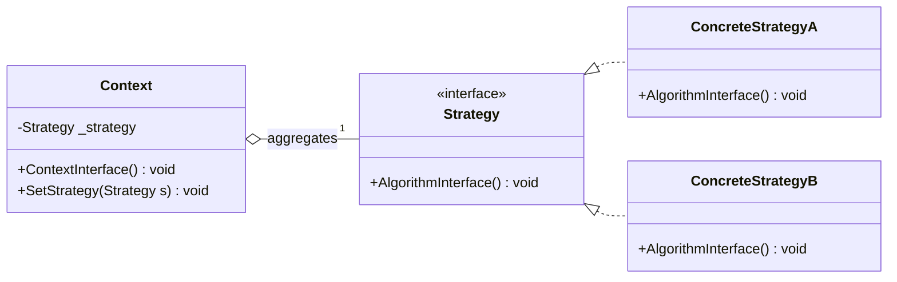
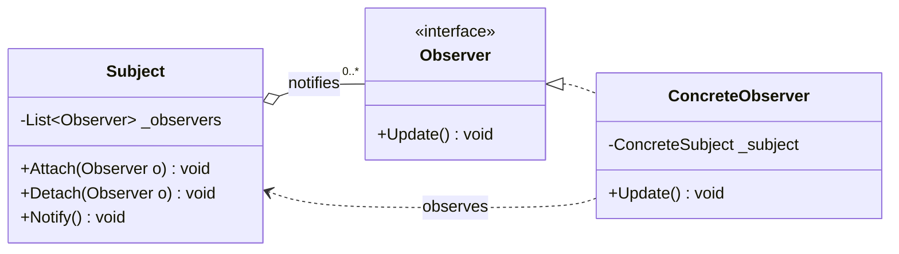

# UML Диаграмма классов проекта Shapes

Данный документ содержит актуальную архитектуру проекта:
1. **Каноническую схему паттерна «Стратегия» (Strategy, GoF)** и её проекцию на кодовую базу.
2. **Каноническую схему паттерна «Наблюдатель» (Observer, GoF)** и её проекцию на кодовую базу.
3. **Полную диаграмму рабочих классов (Production)** — структура работающей системы с учетом разделения на слои и подсистемы.
4. **Диаграмму тестов и моков (Tests & Mocks)** — модульное тестирование и тестовые дублёры.

---

## 1. Паттерн проектирования «Стратегия» (Strategy, GoF)

### 1.1. Абстрактная схема паттерна (в общем виде)

### 1.2. Проекция на кодовую базу Shapes

| Роль в паттерне GoF | Класс в проекте Shapes | Описание роли |
|---|---|---|
| **Context** | `Shape` | Хранит состояние фигуры (`Id`, `Color`) и ссылку на интерфейс стратегии `_geometry`. Делегирует выполнение алгоритмов (`Move`, `Draw`, `GetParamsString`, `Clone`) объекту стратегии. Позволяет динамически подменять стратегию через `ReplaceGeometry`. |
| **Strategy** | `IShapeGeometry` | Общий интерфейс алгоритмов геометрического представления. Задает единый контракт для перемещения, отрисовки на холсте и вычисления параметров. |
| **ConcreteStrategy** | `CircleGeometry`, `RectangleGeometry`, `LineGeometry`, `TriangleGeometry`, `TextGeometry` | Конкретные реализации алгоритмов под каждую фигуру (математика координат, вызовы методов `ICanvas`). |
| **Client** | `Picture` / Команды CLI | Создаёт контекст `Shape`, передавая ему нужную геометрию, созданную через `Registry`. |

---

## 2. Паттерн проектирования «Наблюдатель» (Observer, GoF)

### 2.1. Абстрактная схема паттерна (в общем виде)

### 2.2. Проекция на кодовую базу Shapes (Двойная роль Picture)

В проекте реализован двухуровневый Observer, где `Picture` выступает одновременно в двух ролях:
1. **`Shape` (Subject) $\rightarrow$ `Picture` (Observer):** Картина подписывается на каждую входящую фигуру через `IShapeListener`. При вызове `shape.Move()` или смене цвета фигура уведомляет картину через `Picture.OnShapeChanged()`.
2. **`Picture` (Subject) $\rightarrow$ `PictureLogger` (Observer):** Картина управляет подписчиками через `ListenerList<IPictureListener>` / `Subscription`. При любом изменении (добавление, удаление, изменение фигуры) картина транслирует событие внешним наблюдателям (консольному логгеру).

| Роль в паттерне GoF | Класс в проекте Shapes | Описание роли |
|---|---|---|
| **Subject 1** | `Shape` | Субъект первого уровня. Уведомляет слушателей при изменении координат, цвета или замене геометрии. |
| **Observer 1 / Subject 2** | `Picture` | **Observer** для `Shape` (реализует `IShapeListener`) и **Subject** для внешних слушателей (управляет `ListenerList<IPictureListener>`). |
| **Observer 2** | `PictureLogger` | Внешний консольный наблюдатель (реализует `IPictureListener`), логирующий состояние картины в `TextWriter`. |
| **Subscription Token** | `Subscription` | RAII-токен подписки (`IDisposable`), позволяющий безопасно и автоматически отписываться при вызове `Dispose()`. |

---

## 3. Архитектура рабочих классов (Production)

```mermaid
classDiagram
    direction TB

    namespace Shapes_Core {
        class Picture {
            -List~Shape~ _shapes
            -ListenerList~IPictureListener~ _listeners
            -bool _disposed
            +AddShape(Shape shape) void
            +GetShape(string id) Shape
            +DeleteShape(string id) void
            +CloneShape(string id, string newId) void
            +GetShapes() IReadOnlyList~Shape~
            +MovePicture(double dx, double dy) void
            +DrawPicture(ICanvas canvas) void
            +Subscribe(IPictureListener listener) Subscription
            +AddListener(IPictureListener listener) void
            +RemoveListener(IPictureListener listener) void
            +OnShapeChanged(Shape shape) void
            +Dispose() void
        }

        class Shape {
            +string Id
            +Color Color
            -IShapeGeometry _geometry
            -ListenerList~IShapeListener~ _listeners
            +Move(double dx, double dy) void
            +Draw(ICanvas canvas) void
            +ReplaceGeometry(IShapeGeometry newGeometry) void
            +GetTypeName() string
            +GetParamsString() string
            +Clone(string newId) Shape
            +Subscribe(IShapeListener listener) Subscription
            +AddListener(IShapeListener listener) void
            +RemoveListener(IShapeListener listener) void
            +Dispose() void
        }

        class IShapeGeometry {
            <<interface>>
            +string TypeName
            +Move(double dx, double dy) void
            +Draw(ICanvas canvas) void
            +GetParamsString() string
            +Clone() IShapeGeometry
        }

        class Registry {
            -Dictionary~string_Func~ _factories
            +Register(string typeName, Func factory) void
            +Create(string typeName, string rawParams) IShapeGeometry
        }
    }

    namespace Shapes_Core_Listeners {
        class IPictureListener {
            <<interface>>
            +OnPictureChanged(Picture picture) void
        }

        class IShapeListener {
            <<interface>>
            +OnShapeChanged(Shape shape) void
        }

        class ListenerList~T~ {
            -List~T_long~ _listeners
            -Action~T~ _notifyAction
            -long _nextId
            -bool _disposed
            +Subscribe(T listener) Subscription
            +Add(T listener) void
            +Remove(T listener) void
            +Notify() void
            +Dispose() void
        }

        class Subscription {
            -Action _unsubscribe
            +Take() Subscription
            +Dispose() void
        }
    }

    namespace Shapes_Core_Geometries {
        class LineGeometry {
            -double _x1, _y1, _x2, _y2
            +string TypeName
            +Move(double dx, double dy) void
            +Draw(ICanvas canvas) void
            +GetParamsString() string
            +Clone() IShapeGeometry
            +Parse(string raw)$ LineGeometry
        }

        class CircleGeometry {
            -double _x, _y, _r
            +string TypeName
            +Move(double dx, double dy) void
            +Draw(ICanvas canvas) void
            +GetParamsString() string
            +Clone() IShapeGeometry
            +Parse(string raw)$ CircleGeometry
        }

        class RectangleGeometry {
            -double _left, _top, _width, _height
            +string TypeName
            +Move(double dx, double dy) void
            +Draw(ICanvas canvas) void
            +GetParamsString() string
            +Clone() IShapeGeometry
            +Parse(string raw)$ RectangleGeometry
        }

        class TriangleGeometry {
            -double _x1, _y1, _x2, _y2, _x3, _y3
            +string TypeName
            +Move(double dx, double dy) void
            +Draw(ICanvas canvas) void
            +GetParamsString() string
            +Clone() IShapeGeometry
            +Parse(string raw)$ TriangleGeometry
        }

        class TextGeometry {
            -double _left, _top, _fontSize
            -string _text
            +string TypeName
            +Move(double dx, double dy) void
            +Draw(ICanvas canvas) void
            +GetParamsString() string
            +Clone() IShapeGeometry
            +Parse(string raw)$ TextGeometry
        }
    }

    namespace Shapes_Observers {
        class PictureLogger {
            -TextWriter _output
            +OnPictureChanged(Picture picture) void
        }
    }

    namespace Shapes_Gfx_and_Formatting {
        class ICanvas {
            <<interface>>
            +SetColor(Color color) void
            +MoveTo(double x, double y) void
            +LineTo(double x, double y) void
            +DrawEllipse(double cx, double cy, double rx, double ry) void
            +DrawText(double left, double top, double fontSize, string text) void
        }

        class SvgCanvas {
            -List~string~ _elements
            -double _width, _height
            -double _currentX, _currentY
            -string _currentColor
            +SetColor(Color color) void
            +MoveTo(double x, double y) void
            +LineTo(double x, double y) void
            +DrawEllipse(double cx, double cy, double rx, double ry) void
            +DrawText(double left, double top, double fontSize, string text) void
            +Save(string path) void
        }

        class ConsoleDebugCanvas {
            +SetColor(Color color) void
            +MoveTo(double x, double y) void
            +LineTo(double x, double y) void
            +DrawEllipse(double cx, double cy, double rx, double ry) void
            +DrawText(double left, double top, double fontSize, string text) void
        }

        class Color {
            <<record struct>>
            +byte R
            +byte G
            +byte B
            +ToString() string
        }

        class NumberFormat {
            <<static>>
            +Parse(string s)$ double
            +Format(double v)$ string
        }
    }

    namespace Shapes_Commands {
        class ICommand {
            <<interface>>
            +Execute(string argsRaw) string
        }

        class CommandDispatcher {
            -Dictionary~string_ICommand~ _commands
            -TextWriter _output
            +Register(string name, ICommand command) void
            +Dispatch(string line) void
        }

        class ColorParser {
            <<static>>
            +Parse(string value)$ Color
        }

        class AddShapeCommand {
            -Picture _picture
            -Registry _registry
            +Execute(string args) string
        }

        class ChangeShapeCommand {
            -Picture _picture
            -Registry _registry
            +Execute(string args) string
        }

        class ChangeColorCommand {
            -Picture _picture
            +Execute(string args) string
        }

        class MoveShapeCommand {
            -Picture _picture
            +Execute(string args) string
        }

        class MovePictureCommand {
            -Picture _picture
            +Execute(string args) string
        }

        class DeleteShapeCommand {
            -Picture _picture
            +Execute(string args) string
        }

        class CloneShapeCommand {
            -Picture _picture
            +Execute(string args) string
        }

        class DrawShapeCommand {
            -Picture _picture
            -ICanvas _canvas
            +Execute(string args) string
        }

        class DrawPictureCommand {
            -Picture _picture
            -ICanvas _canvas
            +Execute(string args) string
        }

        class ListCommand {
            -Picture _picture
            -TextWriter _output
            +Execute(string args) string
        }
    }

    namespace ShapesApp {
        class Bootstrap {
            <<static>>
            +Create()$ Tuple
        }

        class Program {
            <<static>>
            +Main(string[] args)$ void
        }
    }

    %% Реализации IDisposable
    IDisposable <|.. Picture
    IDisposable <|.. Shape
    IDisposable <|.. ListenerList~T~
    IDisposable <|.. Subscription

    %% Связи внутри Core (Композиция фигур и стратегии)
    Picture "1" *-- "0..*" Shape
    Shape "1" *-- "1" IShapeGeometry
    Shape ..> ICanvas : "uses"
    Registry ..> IShapeGeometry : "creates"

    %% Реализация стратегий геометрии
    IShapeGeometry <|.. LineGeometry
    IShapeGeometry <|.. CircleGeometry
    IShapeGeometry <|.. RectangleGeometry
    IShapeGeometry <|.. TriangleGeometry
    IShapeGeometry <|.. TextGeometry

    %% Зависимость геометрии от холста
    IShapeGeometry ..> ICanvas : "uses"

    %% Подсистема Observer: Picture как Observer за Shape
    IShapeListener <|.. Picture : "implements"
    Shape *-- "1" ListenerList~IShapeListener~
    ListenerList~IShapeListener~ ..> IShapeListener : "notifies"

    %% Подсистема Observer: Picture как Subject для внешних слушателей
    Picture *-- "1" ListenerList~IPictureListener~
    ListenerList~IPictureListener~ ..> IPictureListener : "notifies"
    ListenerList~T~ ..> Subscription : "creates"
    IPictureListener <|.. PictureLogger

    %% Связи внутри Gfx
    ICanvas <|.. SvgCanvas
    ICanvas <|.. ConsoleDebugCanvas

    %% Связи в слое Commands
    ColorParser ..> Color
    CommandDispatcher --> ICommand : "registers 0..*"
    ICommand ..> Picture : "operates on"

    ICommand <|.. AddShapeCommand
    ICommand <|.. ChangeShapeCommand
    ICommand <|.. ChangeColorCommand
    ICommand <|.. MoveShapeCommand
    ICommand <|.. MovePictureCommand
    ICommand <|.. DeleteShapeCommand
    ICommand <|.. CloneShapeCommand
    ICommand <|.. DrawShapeCommand
    ICommand <|.. DrawPictureCommand
    ICommand <|.. ListCommand

    AddShapeCommand ..> Registry : "uses"
    ChangeShapeCommand ..> Registry : "uses"
    DrawShapeCommand ..> ICanvas : "uses"
    DrawPictureCommand ..> ICanvas : "uses"

    %% Связи в ShapesApp
    Bootstrap ..> CommandDispatcher : "creates / configures"
    Bootstrap ..> Registry : "configures"
    Bootstrap ..> PictureLogger : "creates & attaches"
    Program ..> Bootstrap : "calls"
```

---

## 4. Тестовые классы и моки (Tests & Mocks)

```mermaid
classDiagram
    direction TB

    namespace Shapes_Tests {
        class PictureTests {
            +AddShape_DuplicateId_ThrowsInvalidOperationException() void
        }

        class ShapeTests {
            +Move_ChangesCoordinates_GeometryReceivesCorrectDeltas() void
            +ReplaceGeometry_SwapsActiveStrategy() void
            +Draw_SetsColor_DelegatesToGeometryWithCorrectCanvas() void
            +Clone_CreatesIndependentCopy_SameState() void
            +Move_OnClone_DoesNotAffectOriginal() void
        }

        class ShapeObserverTests {
            +Move_NotifiesListener() void
            +AddListener_Twice_DoesNotDuplicateNotifications() void
        }

        class PictureObserverTests {
            +AddShape_NotifiesExternalListeners() void
            +MoveShape_DirectReference_NotifiesPictureListeners() void
            +DeleteShape_NotifiesExternalListeners() void
            +DeleteShape_UnsubscribesFromShape_DirectMoveDoesNotNotify() void
            +MultipleListeners_AllReceiveNotifications() void
            +RemoveListener_StopsReceivingNotifications() void
            +FailedOperation_DoesNotNotifyListeners() void
        }

        class PictureLoggerTests {
            +AddShape_NotifiesLogger_OutputsPictureChangedAndShapeDetails() void
            +OnPictureChanged_EmptyPicture_OutputsEmptyMessage() void
            +DeleteLastShape_NotifiesLoggerWithEmptyPicture() void
        }

        class ListenerListTests {
            +Listener_RemovesAnother_SecondDoesNotGetNotified() void
            +Listener_RemovesOne_OthersStillNotified() void
        }
    }

    namespace Shapes_Tests_Mocks {
        class FakeCanvas {
            -List~CanvasCall~ _calls
            +IReadOnlyList~CanvasCall~ Calls
            +SetColor(Color color) void
            +MoveTo(double x, double y) void
            +LineTo(double x, double y) void
            +DrawEllipse(double cx, double cy, double rx, double ry) void
            +DrawText(double left, double top, double fontSize, string text) void
        }

        class FakeGeometry {
            +IReadOnlyList~double_double~ MoveCalls
            +int DrawCallCount
            +int DrawOrder
            +ICanvas LastCanvas
            +FakeGeometry LastClonedResult
            +int CloneCallCount
            +string TypeName
            +Move(double dx, double dy) void
            +Draw(ICanvas canvas) void
            +GetParamsString() string
            +Clone() IShapeGeometry
        }

        class FakeShapeListener {
            +int CallCount
            +Shape LastNotifiedShape
            +OnShapeChanged(Shape shape) void
        }

        class FakePictureListener {
            +int CallCount
            +Picture LastNotifiedPicture
            +OnPictureChanged(Picture picture) void
        }

        class SelfRemovingPictureListener {
            +OnPictureChanged(Picture picture) void
        }

        class OrderCounter {
            -int _next
            +Next() int
        }

        class CanvasCall {
            <<record>>
            +int Order
            +string Method
            +object[] Args
        }
    }

    class ICanvas {
        <<interface>>
    }

    class IShapeGeometry {
        <<interface>>
    }

    class IShapeListener {
        <<interface>>
    }

    class IPictureListener {
        <<interface>>
    }

    %% Реализации интерфейсов моками
    ICanvas <|.. FakeCanvas
    IShapeGeometry <|.. FakeGeometry
    IShapeListener <|.. FakeShapeListener
    IPictureListener <|.. FakePictureListener
    IPictureListener <|.. SelfRemovingPictureListener

    FakeCanvas *-- "0..*" CanvasCall
    FakeCanvas ..> OrderCounter
    FakeGeometry ..> OrderCounter

    %% Использование в тестах
    ShapeTests ..> FakeGeometry : "uses"
    ShapeTests ..> FakeCanvas : "uses"
    ShapeObserverTests ..> FakeShapeListener : "uses"
    PictureObserverTests ..> FakePictureListener : "uses"
    PictureObserverTests ..> SelfRemovingPictureListener : "uses"
```

