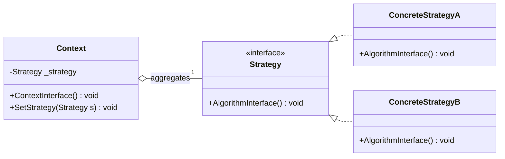
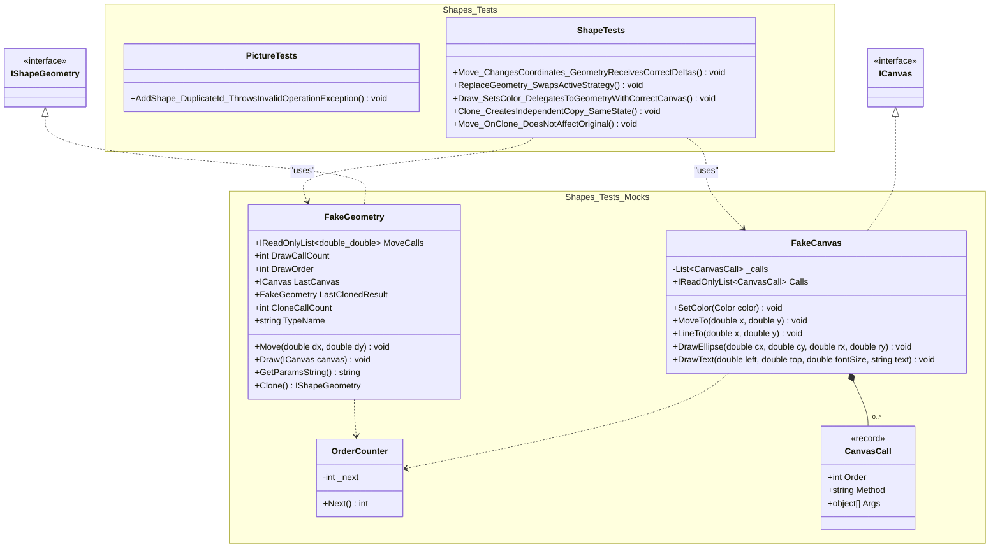

# UML Диаграмма классов проекта Shapes

Данный документ содержит схемы архитектуры проекта:
1. **Каноническую схему паттерна «Стратегия» (GoF)** в общем виде и её проекцию на классы проекта.
2. **Диаграмму классов предметной области (Production)** — структура работающей системы.
3. **Диаграмму тестов и моков (Tests & Mocks)** — изолированное модульное тестирование.

> **Примечание:** Элементы паттерна **Наблюдатель (Observer)** намеренно исключены из схемы согласно требованиям к текущему этапу.

---

## 1. Паттерн проектирования «Стратегия» (Strategy, GoF)

### 1.1. Абстрактная схема паттерна (в общем виде)

### 1.2. Проекция на кодовую базу Shapes

| Роль в паттерне GoF | Класс в проекте Shapes | Описание роли |
|---|---|---|
| **Context** | `Shape` | Хранит состояние фигуры (`Id`, `Color`) и ссылку на интерфейс стратегии `_geometry`. Делегирует выполнение алгоритмов (`Move`, `Draw`, `GetParamsString`, `Clone`) объекту стратегии. Позволяет динамически подменять стратегию через `ReplaceGeometry`. |
| **Strategy** | `IShapeGeometry` | Общий интерфейс алгоритмов геометрического представления. Задает единый контракт для перемещения, отрисовки на холсте и вычисления параметров. |
| **ConcreteStrategy** | `CircleGeometry`, `RectangleGeometry`, `LineGeometry`, `TriangleGeometry`, `TextGeometry` | Конкретные реализации алгоритмов под каждую фигуру (математика координат, вызовы методов `ICanvas`). |
| **Client** | `Picture` / Команды CLI | Создаёт контекст `Shape`, передавая ему нужную геометрию, созданную через `Registry`. |

---

## 2. Архитектура рабочих классов (Production)

```mermaid
classDiagram
    direction TB

    namespace Shapes_Core {
        class Picture {
            -List~Shape~ _shapes
            +AddShape(Shape shape) void
            +GetShape(string id) Shape
            +DeleteShape(string id) void
            +CloneShape(string id, string newId) void
            +GetShapes() IReadOnlyList~Shape~
            +MovePicture(double dx, double dy) void
            +DrawPicture(ICanvas canvas) void
        }

        class Shape {
            +string Id
            +Color Color
            -IShapeGeometry _geometry
            +Move(double dx, double dy) void
            +Draw(ICanvas canvas) void
            +ReplaceGeometry(IShapeGeometry newGeometry) void
            +GetTypeName() string
            +GetParamsString() string
            +Clone(string newId) Shape
        }

        class IShapeGeometry {
            <<interface>>
            +string TypeName
            +Move(double dx, double dy) void
            +Draw(ICanvas canvas) void
            +GetParamsString() string
            +Clone() IShapeGeometry
        }

        class Registry {
            -Dictionary~string_Func~ _factories
            +Register(string typeName, Func factory) void
            +Create(string typeName, string rawParams) IShapeGeometry
        }

        class LineGeometry {
            -double _x1
            -double _y1
            -double _x2
            -double _y2
            +string TypeName
            +Move(double dx, double dy) void
            +Draw(ICanvas canvas) void
            +GetParamsString() string
            +Clone() IShapeGeometry
            +Parse(string raw)$ LineGeometry
        }

        class CircleGeometry {
            -double _x
            -double _y
            -double _r
            +string TypeName
            +Move(double dx, double dy) void
            +Draw(ICanvas canvas) void
            +GetParamsString() string
            +Clone() IShapeGeometry
            +Parse(string raw)$ CircleGeometry
        }

        class RectangleGeometry {
            -double _left
            -double _top
            -double _width
            -double _height
            +string TypeName
            +Move(double dx, double dy) void
            +Draw(ICanvas canvas) void
            +GetParamsString() string
            +Clone() IShapeGeometry
            +Parse(string raw)$ RectangleGeometry
        }

        class TriangleGeometry {
            -double _x1
            -double _y1
            -double _x2
            -double _y2
            -double _x3
            -double _y3
            +string TypeName
            +Move(double dx, double dy) void
            +Draw(ICanvas canvas) void
            +GetParamsString() string
            +Clone() IShapeGeometry
            +Parse(string raw)$ TriangleGeometry
        }

        class TextGeometry {
            -double _left
            -double _top
            -double _fontSize
            -string _text
            +string TypeName
            +Move(double dx, double dy) void
            +Draw(ICanvas canvas) void
            +GetParamsString() string
            +Clone() IShapeGeometry
            +Parse(string raw)$ TextGeometry
        }
    }

    namespace Shapes_Gfx_and_Formatting {
        class ICanvas {
            <<interface>>
            +SetColor(Color color) void
            +MoveTo(double x, double y) void
            +LineTo(double x, double y) void
            +DrawEllipse(double cx, double cy, double rx, double ry) void
            +DrawText(double left, double top, double fontSize, string text) void
        }

        class SvgCanvas {
            -List~string~ _elements
            -double _width
            -double _height
            -double _currentX
            -double _currentY
            -string _currentColor
            +SetColor(Color color) void
            +MoveTo(double x, double y) void
            +LineTo(double x, double y) void
            +DrawEllipse(double cx, double cy, double rx, double ry) void
            +DrawText(double left, double top, double fontSize, string text) void
            +Save(string path) void
        }

        class ConsoleDebugCanvas {
            +SetColor(Color color) void
            +MoveTo(double x, double y) void
            +LineTo(double x, double y) void
            +DrawEllipse(double cx, double cy, double rx, double ry) void
            +DrawText(double left, double top, double fontSize, string text) void
        }

        class Color {
            <<record struct>>
            +byte R
            +byte G
            +byte B
            +ToString() string
        }

        class NumberFormat {
            <<static>>
            +Parse(string s)$ double
            +Format(double v)$ string
        }
    }

    namespace Shapes_Commands {
        class ICommand {
            <<interface>>
            +Execute(string argsRaw) string
        }

        class CommandDispatcher {
            -Dictionary~string_ICommand~ _commands
            -TextWriter _output
            +Register(string name, ICommand command) void
            +Dispatch(string line) void
        }

        class ColorParser {
            <<static>>
            +Parse(string value)$ Color
        }

        class AddShapeCommand {
            -Picture _picture
            -Registry _registry
            +Execute(string args) string
        }

        class ChangeShapeCommand {
            -Picture _picture
            -Registry _registry
            +Execute(string args) string
        }

        class ChangeColorCommand {
            -Picture _picture
            +Execute(string args) string
        }

        class MoveShapeCommand {
            -Picture _picture
            +Execute(string args) string
        }

        class MovePictureCommand {
            -Picture _picture
            +Execute(string args) string
        }

        class DeleteShapeCommand {
            -Picture _picture
            +Execute(string args) string
        }

        class CloneShapeCommand {
            -Picture _picture
            +Execute(string args) string
        }

        class DrawShapeCommand {
            -Picture _picture
            -ICanvas _canvas
            +Execute(string args) string
        }

        class DrawPictureCommand {
            -Picture _picture
            -ICanvas _canvas
            +Execute(string args) string
        }

        class ListCommand {
            -Picture _picture
            -TextWriter _output
            +Execute(string args) string
        }
    }

    namespace ShapesApp {
        class Bootstrap {
            <<static>>
            +Create()$ Tuple
        }

        class Program {
            <<static>>
            +Main(string[] args)$ void
        }
    }

    %% Связи внутри Core
    Picture "1" *-- "0..*" Shape
    Shape "1" *-- "1" IShapeGeometry
    Shape ..> ICanvas : "uses"
    Registry ..> IShapeGeometry : "creates"

    IShapeGeometry <|.. LineGeometry
    IShapeGeometry <|.. CircleGeometry
    IShapeGeometry <|.. RectangleGeometry
    IShapeGeometry <|.. TriangleGeometry
    IShapeGeometry <|.. TextGeometry

    %% Зависимость геометрии от холста для отрисовки
    IShapeGeometry ..> ICanvas : "uses"

    %% Связи внутри Gfx
    ICanvas <|.. SvgCanvas
    ICanvas <|.. ConsoleDebugCanvas

    %% Связи в слое Commands
    ColorParser ..> Color
    CommandDispatcher --> ICommand : "registers 0..*"
    ICommand ..> Picture : "operates on"

    ICommand <|.. AddShapeCommand
    ICommand <|.. ChangeShapeCommand
    ICommand <|.. ChangeColorCommand
    ICommand <|.. MoveShapeCommand
    ICommand <|.. MovePictureCommand
    ICommand <|.. DeleteShapeCommand
    ICommand <|.. CloneShapeCommand
    ICommand <|.. DrawShapeCommand
    ICommand <|.. DrawPictureCommand
    ICommand <|.. ListCommand

    AddShapeCommand ..> Registry : "uses"
    ChangeShapeCommand ..> Registry : "uses"
    DrawShapeCommand ..> ICanvas : "uses"
    DrawPictureCommand ..> ICanvas : "uses"

    %% Связи в ShapesApp
    Bootstrap ..> CommandDispatcher : "creates / configures"
    Bootstrap ..> Registry : "configures"
    Program ..> Bootstrap : "calls"
```

---

## 3. Тестовые классы и моки (Tests & Mocks)

